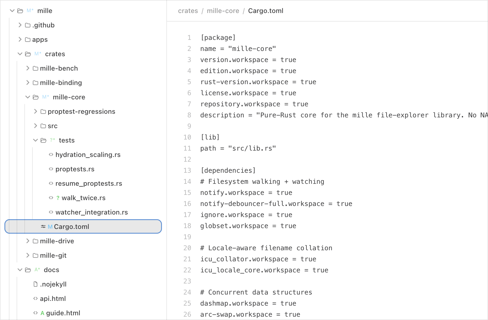
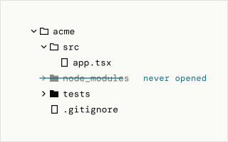
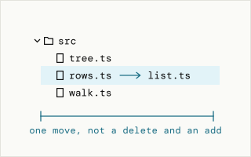
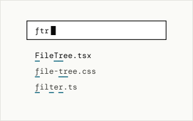
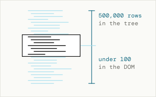
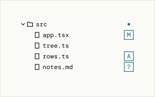
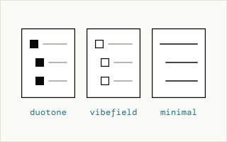

<p align="center">
  <a href="https://vibecook-dev.github.io/mille/">
    <picture>
      <source media="(prefers-color-scheme: dark)" srcset=".github/readme/hero-dark.svg">
      
    </picture>
  </a>
</p>

<p align="center">
  <b>A file explorer for your Electron app.</b><br>
  A Rust engine walks, watches and searches the folder.<br>
  React draws only the rows on screen.
</p>

<p align="center">
  <a href="https://vibecook-dev.github.io/mille/"><b>Website</b></a>&nbsp;&nbsp;·&nbsp;
  <a href="https://vibecook-dev.github.io/mille/api.html">API</a>&nbsp;&nbsp;·&nbsp;
  <a href="apps/playground/EMBEDDING_UI.md">Embedding guide</a>&nbsp;&nbsp;·&nbsp;
  <a href="https://www.npmjs.com/package/@vibecook/mille">npm</a>&nbsp;&nbsp;·&nbsp;
  <a href="CHANGELOG.md">Changelog</a>
</p>

<p align="center">
  <a href="https://github.com/vibecook-dev/mille/actions/workflows/ci.yml"><picture><source media="(prefers-color-scheme: dark)" srcset="https://img.shields.io/github/actions/workflow/status/vibecook-dev/mille/ci.yml?branch=main&label=ci&style=flat-square&labelColor=262624&color=fafaf7"></picture></a>
  <a href="https://www.npmjs.com/package/@vibecook/mille"><picture><source media="(prefers-color-scheme: dark)" srcset="https://img.shields.io/npm/v/%40vibecook%2Fmille?label=mille&style=flat-square&labelColor=262624&color=fafaf7"></picture></a>
  <a href="https://www.npmjs.com/package/@vibecook/mille-ui"><picture><source media="(prefers-color-scheme: dark)" srcset="https://img.shields.io/npm/v/%40vibecook%2Fmille-ui?label=mille-ui&style=flat-square&labelColor=262624&color=fafaf7"></picture></a>
  <a href="LICENSE"><picture><source media="(prefers-color-scheme: dark)" srcset="https://img.shields.io/badge/license-MIT-fafaf7?style=flat-square&labelColor=262624"></picture></a>
</p>

<br>

<p align="center">
  <picture>
    <source media="(prefers-color-scheme: dark)" srcset=".github/readme/explorer-dark.png">
    
  </picture>
</p>

<p align="center"><sub><code>FileTree</code> in its VibeField theme, on a copy of this repository with a few uncommitted changes. A screenshot, not a mock.</sub></p>

## Embed it

```bash
npm install @vibecook/mille @vibecook/mille-ui @tanstack/react-virtual
```

```ts
// Utility process: the engine
import { createFileExplorerHost } from '@vibecook/mille/host';

const host = await createFileExplorerHost({
  roots: ['/path/to/project'],
  initialWalk: 'roots-only',
});
process.parentPort.on('message', ({ ports }) => host.attachPort(wrapMessagePortMain(ports[0])));
```

```tsx
// Renderer: connect over the port, and draw
import { connectFileExplorer } from '@vibecook/mille/port';
import { FileTree } from '@vibecook/mille-ui';
import { duotoneIconTheme } from '@vibecook/mille-ui/icons/duotone';
import '@vibecook/mille-ui/tokens.css';

const fx = await connectFileExplorer(port);

<FileTree fx={fx} ariaLabel="Files" iconTheme={duotoneIconTheme} />;
```

`wrapMessagePortMain` is a short adapter for Electron's port, and the main process and preload only pass the port along. The [embedding guide](apps/playground/EMBEDDING_UI.md) has all four files. Needs React 19 and Node 20 or later; CI runs it in Electron 41.

## How a change reaches the screen

<p align="center">
  <picture>
    <source media="(prefers-color-scheme: dark)" srcset=".github/readme/path-dark.svg">
    
  </picture>
</p>

The engine runs in its own process. Your window holds a small frozen mirror, and only the rows in view cross the port as full records.

## What you get

<table>
  <tr>
    <td width="33%" valign="top">
      <picture><source media="(prefers-color-scheme: dark)" srcset=".github/readme/tile-walk-dark.svg"></picture>
      <b>Parallel walk</b><br>
      Reads the tree on several threads, and applies <code>.gitignore</code> before it descends.
    </td>
    <td width="33%" valign="top">
      <picture><source media="(prefers-color-scheme: dark)" srcset=".github/readme/tile-watch-dark.svg"></picture>
      <b>Live watch</b><br>
      Changes on disk arrive as small deltas, and a rename is paired into one move.
    </td>
    <td width="33%" valign="top">
      <picture><source media="(prefers-color-scheme: dark)" srcset=".github/readme/tile-search-dark.svg"></picture>
      <b>Fuzzy search</b><br>
      File-name search with <code>nucleo</code>, run in the engine over the whole tree.
    </td>
  </tr>
  <tr>
    <td width="33%" valign="top">
      <picture><source media="(prefers-color-scheme: dark)" srcset=".github/readme/tile-rows-dark.svg"></picture>
      <b>Virtualized rows</b><br>
      CI runs a 500,000-row tree and fails if more than 100 rows reach the DOM.
    </td>
    <td width="33%" valign="top">
      <picture><source media="(prefers-color-scheme: dark)" srcset=".github/readme/tile-decorations-dark.svg"></picture>
      <b>Decorations</b><br>
      Git status letters, plus diagnostics, test results and editor state from your own providers.
    </td>
    <td width="33%" valign="top">
      <picture><source media="(prefers-color-scheme: dark)" srcset=".github/readme/tile-themes-dark.svg"></picture>
      <b>Themes</b><br>
      Five icon themes and two tree themes. Any VS Code file icon theme loads too.
    </td>
  </tr>
</table>

Also: multi-root workspaces, compact folders, file nesting, drag and drop, inline rename, undo for create, rename, move and delete, and a WAI-ARIA tree that CI audits with axe. A Rust panic reaches you as a JavaScript error you can catch, not as a dead editor.

## Over a tailnet

<p align="center">
  <picture>
    <source media="(prefers-color-scheme: dark)" srcset=".github/readme/remote-dark.svg">
    
  </picture>
</p>

`@vibecook/mille-truffle` serves a folder to another device on your tailnet, over [truffle](https://github.com/vibecook-dev/truffle). The other device runs the same mirror and the same `FileTree`. It is experimental: see its [README](packages/mille-truffle/README.md) and the [mesh demo](apps/mesh-demo).

## Packages

| Need                            | Use                                   |
| ------------------------------- | ------------------------------------- |
| A file tree in React            | `@vibecook/mille-ui`                  |
| The engine                      | `@vibecook/mille`                     |
| Your own tree UI on the engine  | `@vibecook/mille-ui/headless`         |
| A workspace on another device   | `@vibecook/mille-truffle`             |
| A client over WebSocket         | `@vibecook/mille/remote` with `/node` |
| A virtual file system           | `@vibecook/mille/provider`            |
| A synced store of file versions | `@vibecook/mille/drive`               |

Prebuilt for macOS, Windows and Linux, on x64 and arm64, with glibc and musl builds for Linux. npm installs the one that matches.

## Status

- **0.x.** The API can still change between releases.
- **Git** badges come from the `git` on your `PATH`. The native git engine in `crates/mille-git` is not in the published binaries yet.
- **Symlinked folders** use `followSymlinks: 'smart'` by default. Each walk prefers ordinary directories and visits each reachable directory target once. Set it to `false` to skip linked subtrees, or `true` to traverse each alias with ancestor-cycle protection.
- **Remote workspaces** (`mille-truffle`) are experimental.

<details>
<summary><b>Development</b></summary>

<br>

```bash
pnpm install
pnpm --filter @vibecook/mille run build:napi:debug
pnpm --filter @vibecook/mille run build:ts
pnpm --filter @vibecook/mille-ui run build
pnpm --filter playground dev          # the reference app

cargo test --workspace --exclude mille-binding
pnpm -r --if-present test             # tests import dist/, so build first
pnpm bench:watch                      # the watcher benchmark, in Electron
```

Needs Node 20 or later, pnpm 10, and Rust 1.97.1, which `rust-toolchain.toml` pins. The benchmark is described in [WATCH_BENCH.md](apps/playground/WATCH_BENCH.md). Releases are cut by release-please and published to npm with trusted publishing.

</details>

<br>

<p align="center">
  <a href="https://github.com/jamesyong-42">
    <picture>
      <source media="(prefers-color-scheme: dark)" srcset=".github/readme/james-yong-dark.svg">
      
    </picture>
  </a>
</p>

<p align="center">
  <sub><a href="LICENSE">MIT</a> © 2026 James Yong. mille is a <a href="https://github.com/vibecook-dev">vibecook</a> project.</sub>
</p>
